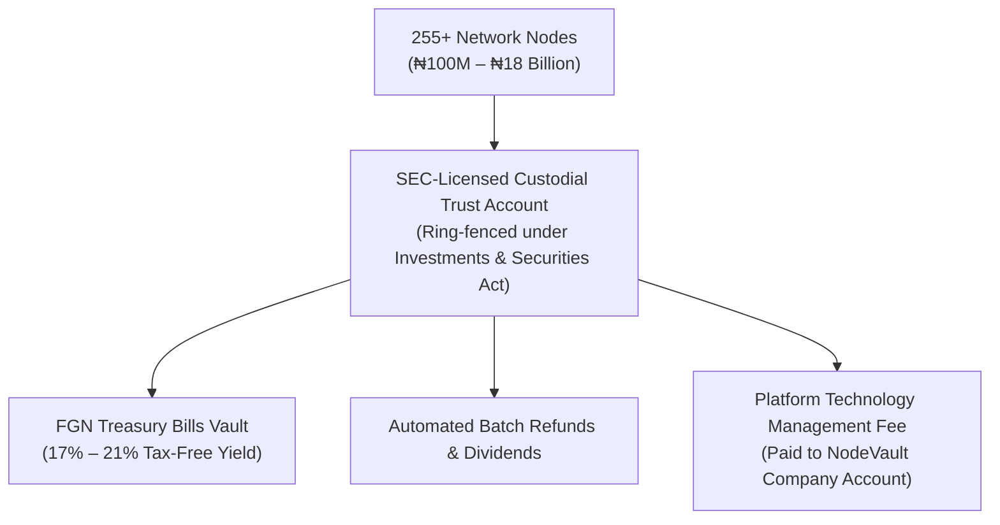
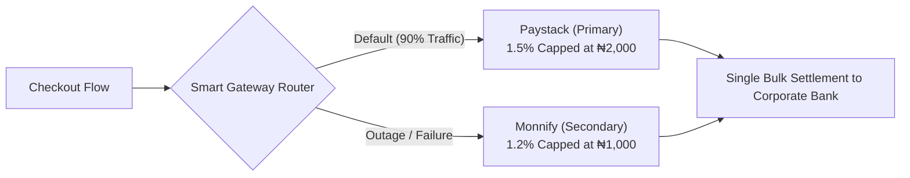

# NodeVault — Comprehensive Legal, Tax, Gateway & Treasury Strategy

> **Confidential Operational Blueprint**  
> **Jurisdiction:** Nigeria (₦ NGN) · United States ($ USD)  
> **Governing Laws:** Companies Income Tax Act (CITA), Value Added Tax Act, Personal Income Tax Act (PITA), Money Laundering Act 2022, Investments & Securities Act (ISA).

---

## Table of Contents
1. [Executive Summary & Core Financial Premise](#1-executive-summary--core-financial-premise)
2. [Nigerian Taxation Framework & Statutory Liabilities](#2-nigerian-taxation-framework--statutory-liabilities)
3. [Treasury Bill Exemption & Tax Optimization](#3-treasury-bill-exemption--tax-optimization)
4. [Scaling to ₦18 Billion: Institutional Trustee & Custodian Model](#4-scaling-to-18-billion-institutional-trustee--custodian-model)
5. [Legal Setup & Implementation Cost Breakdown](#5-legal-setup--implementation-cost-breakdown)
6. [Dual-Gateway Strategy (Paystack Primary + Monnify Secondary)](#6-dual-gateway-strategy-paystack-primary--monnify-secondary)
7. [Inbound Checkout Fee Architecture & Tier Scaling Table](#7-inbound-checkout-fee-architecture--tier-scaling-table)
8. [Withdrawal Governance & Security Limits](#8-withdrawal-governance--security-limits)
9. [Refund Reserve Treasury Management (3-Day Rule & End-of-Month Cycle)](#9-refund-reserve-treasury-management-3-day-rule--end-of-month-cycle)
10. [Mandatory In-App Compliance & Software Features](#10-mandatory-in-app-compliance--software-features)

---

## 1. Executive Summary & Core Financial Premise

NodeVault operates a 255-node matrix per group across 15 progressive tiers (ranging from ₦1,000 Micro Nodes up to ₦2,560,000 Genesis Supreme Nodes). 

Under the core financial flow:
* **User Gifts (15%, 7.5%, 3%):** Distributed back to participants.
* **Capital Protection Refunds:** Set aside for non-earning levels (Level 7 @ 70% refund, Level 6 @ 60% threshold).
* **Platform Retained (22.84%):** Core retained liquidity deployed into sovereign yield instruments (FGN Treasury Bills).

The strategy detailed herein ensures:
1. **Zero Tax Penalties:** Full compliance with FIRS while legally driving corporate tax down to near 0%.
2. **Account Safety:** Complete immunity from bank freezes, PND (Post-No-Debit), and EFCC/NFIU scrutiny.
3. **Compound Treasury Yields:** 100% of idle capital (retained reserves and refund pools) earns 17%–21% risk-free APY.
4. **Maximized Platform Margin:** Additional cash flow generated via gateway spread markups, OPEX fees, and early exit penalties.

---

## 2. Nigerian Taxation Framework & Statutory Liabilities

### How FIRS Treats Node Inflow vs. Platform Turnover
A critical legal and accounting rule: **The platform does NOT recognize total staking deposits as company turnover.** 

Staking capital belongs to the protocol/users held in escrow. The platform's taxable turnover is strictly the **Platform Net Retained (22.84%)** plus **Operating Fees (5%)** and **Gateway Spread**.

| Tax Name | Regulatory Body | Statutory Rate | Taxable Base | Strategic Status |
|:---|:---|:---:|:---|:---|
| **Companies Income Tax (CIT)** | FIRS | 0% / 20% / 30% | Net Corporate Profit | • **0%** if turnover ≤ ₦25M (Small Co.) • **20%** if turnover ₦25M–₦100M • **30%** if turnover > ₦100M |
| **Tertiary Education Tax (EDT)** | FIRS | 3.0% | Assessable Profit | Exempt for small companies (≤ ₦25M) |
| **Value Added Tax (VAT)** | FIRS | 7.5% | Service & OPEX Fees Only | Non-vatable on principal stakes; remitted on platform fees |
| **Withholding Tax (WHT)** | FIRS / State IRS | 10% | Distributed Dividends | Final tax only when withdrawing corporate profit to personal accounts |
| **Electronic Money Transfer Levy (EMTL)** | CBN / FIRS | ₦50 flat | Transfers ≥ ₦10,000 | Statutory bank transfer levy |

---

## 3. Treasury Bill Exemption & Tax Optimization

### The FGN Sovereign Debt Tax Shelter
Under the Companies Income Tax Act (CITA) and statutory exemption orders:
* **Interest earned on Federal Government of Nigeria (FGN) Treasury Bills and Bonds is 100% EXEMPT from Companies Income Tax (CIT) and Withholding Tax (WHT).**
* Banks and discount houses credit the gross yield without withholding tax deductions.

### Tax Treatment Comparison
* If you earn ₦100,000,000 from normal business trading: FIRS collects **~₦30,000,000** in CIT + EDT.
* If you earn ₦100,000,000 from FGN Treasury Bill interest: You pay **₦0.00** in CIT.

### FIRS Reporting Strategy
On the annual **FIRS TaxPro-Max** return, Treasury Bill earnings must be reported under the **"Exempt Income / Government Securities Schedule"**, ensuring complete legal transparency while shielding profits from tax liabilities.

---

## 4. Scaling to ₦18 Billion: Institutional Trustee & Custodian Model

### Why Personal or Standard Corporate Accounts Fail at Scale
Under the **Money Laundering Act 2022**:
* Inflows of ₦10,000,000+ in corporate accounts trigger automatic Currency Transaction Reports (CTR) to the NFIU.
* Inflows reaching hundreds of millions or billions without an institutional financial umbrella trigger automated **PND (Post-No-Debit) freezes** by commercial bank compliance departments.

### The Institutional Solution (Used by PiggyVest, Cowrywise, Bamboo)
To manage ₦100 Million up to ₦18 Billion, NodeVault partners with an **SEC-Licensed Trustee and Custodian** (e.g., *Stanbic IBTC Trustees, Meristem Trustees, STL Trustees, United Capital Trustees*).

### The 4 Non-Negotiable Contract Clauses (Protecting Your Control)
To ensure the platform founder **never has to fight for the money**, the **Trust Deed** must mandate:
1. **Immediate Execution Mandate:** The Custodian must execute all automated API disbursement instructions within 24 hours without discretionary review.
2. **Right to Terminate & Port (The "Fire Clause"):** NodeVault retains the unconditional right to terminate the Trustee with 30–60 days' written notice and transfer the entire portfolio to another licensed institution.
3. **Ring-Fenced CSCS Registration:** Assets at the Central Securities Clearing System (CSCS) are registered in a segregated sub-account (`[Trustee Name] / NodeVault Protocol Reserve Account`), making them immune from trustee bankruptcy.
4. **Unrestricted Profit Sweep:** All yields and interest exceeding user payout obligations belong exclusively to NodeVault and must be swept into the operational account on demand.

---

## 5. Legal Setup & Implementation Cost Breakdown

### A. One-Time Setup Costs

| Component | Scope & Purpose | Estimated Cost (₦) |
|:---|:---|---:|
| **CAC Incorporation (Ltd)** | Registering Private Limited Company with relevant tech/clearing objects and filing capital stamp duties. | ₦200,000 – ₦500,000 |
| **Fintech Legal Counsel** | Drafting Platform Terms, Staking Agreements, and negotiating the Trust Deed & SLA. | ₦2,500,000 – ₦5,000,000 |
| **SCUML Certification** | EFCC anti-money laundering registration to protect bank accounts. | ₦150,000 – ₦300,000 |
| **Trustee Onboarding Fee** | Institutional setup and legal file opening with licensed Trustee firm. | ₦1,000,000 – ₦2,500,000 |
| **Total One-Time Legal Setup** | | **~₦3,850,000 – ₦8,300,000** |

### B. Ongoing Annual Trustee Fees (Based on Assets Under Management - AUM)

| Vault Scale | Annual Trustee Rate | Annual Fee Paid | Annual T-Bill Earnings (~19% APY) |
|:---|:---:|---:|---:|
| **₦100 Million** | 0.25% / year | ₦250,000 | **+₦19,000,000** |
| **₦1 Billion** | 0.15% / year | ₦1,500,000 | **+₦190,000,000** |
| **₦18 Billion** | 0.08% – 0.10% / year | ~₦14,400,000 | **+₦3,420,000,000** |

*The Treasury Bill interest pays for the trustee management fee over 200× over.*

---

## 6. Dual-Gateway Strategy (Paystack Primary + Monnify Secondary)

### Gateway Roles & Redundancy
* **Paystack (Primary):** Industry gold-standard UI, highest card success rate, automated bulk transfer API. Cost: **1.5% capped at ₦2,000**.
* **Monnify (Secondary / Fallback):** Optimized for direct bank transfers and dynamic virtual accounts (NUBAN). Lowest cost: **1.0%–1.2% capped at ₦1,000**.
* **Why Bank Settlements Protect You:** Users never transfer directly to your corporate account number. Settlements arrive as clean, bulk corporate payouts from Paystack or Monnify, eliminating arbitrary AML keyword flags.

---

## 7. Inbound Checkout Fee Architecture & Tier Scaling Table

To maximize revenue while adhering to FCCPC transparent pricing rules, checkout separates the charges into itemized components:
1. **Base Staking Fee:** Tier entry fee (100% enters the matrix pool).
2. **Platform Operating Fee (OPEX):** **5.0%** platform infrastructure and maintenance charge.
3. **Gateway & Network Processing Fee:** **3.0%** pass-through markup fee.
4. **Value Added Tax (VAT 7.5%):** Applied strictly to service fees (`[5% OPEX + 3% Gateway] × 7.5%`).
5. **Electronic Money Transfer Levy (EMTL):** **₦50 flat** on transactions ≥ ₦10,000.

### Complete Per-User Inbound Fee Schedule (Paystack Primary)

| Tier | Tier Name | Base Staking Fee | Platform OPEX (5%) | Gateway Fee (3%) | VAT (7.5% on Fees) | EMTL | **Total User Checkout Price** | Actual Paystack Fee (Capped) | **Platform Extra Cash Margin** |
|:---:|:---|---:|---:|---:|---:|---:|---:|---:|---:|
| **1** | Micro Node | ₦1,000 | ₦50 | ₦30 | ₦6.00 | ₦0 | **₦1,086.00** | ₦15.00 | **₦65.00** |
| **2** | Spark Node | ₦2,000 | ₦100 | ₦60 | ₦12.00 | ₦0 | **₦2,172.00** | ₦30.00 | **₦130.00** |
| **3** | Alpha Node | ₦4,000 | ₦200 | ₦120 | ₦24.00 | ₦0 | **₦4,344.00** | ₦60.00 | **₦260.00** |
| **4** | Delta Node | ₦8,000 | ₦400 | ₦240 | ₦48.00 | ₦0 | **₦8,688.00** | ₦120.00 | **₦520.00** |
| **5** | Echo Node | ₦16,000 | ₦800 | ₦480 | ₦96.00 | ₦50 | **₦17,426.00** | ₦240.00 | **₦1,040.00** |
| **6** | Prime Node | ₦32,000 | ₦1,600 | ₦960 | ₦192.00 | ₦50 | **₦34,802.00** | ₦480.00 | **₦2,080.00** |
| **7** | Sigma Node | ₦64,000 | ₦3,200 | ₦1,920 | ₦384.00 | ₦50 | **₦69,554.00** | ₦960.00 | **₦4,160.00** |
| **8** | Omega Node | ₦128,000 | ₦6,400 | ₦3,840 | ₦768.00 | ₦50 | **₦139,058.00** | ₦1,920.00 | **₦8,320.00** |
| **9** | Nexus Node | ₦250,000 | ₦12,500 | ₦7,500 | ₦1,500.00 | ₦50 | **₦271,550.00** | ₦2,000 *(Cap)* | **₦18,000.00** |
| **10** | Apex Node | ₦400,000 | ₦20,000 | ₦12,000 | ₦2,400.00 | ₦50 | **₦434,450.00** | ₦2,000 *(Cap)* | **₦30,000.00** |
| **11** | Zenith Node | ₦640,000 | ₦32,000 | ₦19,200 | ₦3,840.00 | ₦50 | **₦695,090.00** | ₦2,000 *(Cap)* | **₦49,200.00** |
| **12** | Nova Node | ₦1,000,000 | ₦50,000 | ₦30,000 | ₦6,000.00 | ₦50 | **₦1,086,050.00** | ₦2,000 *(Cap)* | **₦78,000.00** |
| **13** | Titan Node | ₦1,500,000 | ₦75,000 | ₦45,000 | ₦9,000.00 | ₦50 | **₦1,629,050.00** | ₦2,000 *(Cap)* | **₦118,000.00** |
| **14** | Sovereign Node | ₦2,000,000 | ₦100,000 | ₦60,000 | ₦12,000.00 | ₦50 | **₦2,172,050.00** | ₦2,000 *(Cap)* | **₦158,000.00** |
| **15** | Genesis Supreme | ₦2,560,000 | ₦128,000 | ₦76,800 | ₦15,360.00 | ₦50 | **₦2,780,210.00** | ₦2,000 *(Cap)* | **₦202,800.00** |

### Total Extra Platform Cash Generated Per 255-Node Matrix

Across an entire 255-user completed pool:
* **Tier 1 (Micro):** +₦16,575 extra cash
* **Tier 5 (Echo):** +₦265,200 extra cash
* **Tier 8 (Omega):** +₦2,121,600 extra cash
* **Tier 9 (Nexus):** +₦4,590,000 extra cash
* **Tier 15 (Genesis Supreme):** **+₦51,714,000 extra cash**

$$\text{Tier 15 Total Retained Cash} = ₦149,094,400 \text{ (Base Retained)} + ₦51,714,000 \text{ (Fee Margin)} = \mathbf{₦200,808,400}$$

---

## 8. Withdrawal Governance & Security Limits

### Standard Withdrawal Parameter Matrix

| Parameter | Small Nodes (Tiers 1–5) | Mid Nodes (Tiers 6–8) | Premium Nexus (Tiers 9–15) | United States ($ USD) |
|:---|:---:|:---:|:---:|:---:|
| **Minimum Per Transaction** | **₦2,000** | **₦5,000** | **₦25,000** | **$10** |
| **Maximum Per Single Transaction** | **₦500,000** | **₦2,000,000** | **₦5,000,000** | **$3,000** |
| **Maximum Daily Limit (24h)** | **₦1,000,000** | **₦5,000,000** | **₦10,000,000** | **$6,000** |
| **Execution Window** | Instant Automated API | Instant Automated API | Instant (up to ₦2.5M) Audit clearance (> ₦2.5M) | Instant Automated |

### Outbound Fee Deductions (Gifts, Refunds & Dividends)
When withdrawals are disbursed to users:
1. **Statutory Tax Reserve (15.0%):** Kept in Protocol Reserve Vault for tax provisioning and audit buffers.
2. **Outbound OPEX Fee (5.0%):** Platform operational maintenance.
3. **VAT on OPEX (7.5% of 5% = 0.375%):** Remitted to FIRS.
4. **Outbound Bank Transfer Fee (₦100 flat):**
   * ₦25 – ₦50 paid to Paystack/Monnify Transfers API.
   * **₦50 – ₦75 retained by platform as clearance float.**

---

## 9. Refund Reserve Treasury Management (3-Day Rule & End-of-Month Cycle)

### The 2 Core Protocol Rules
1. **Minimum 3 Business Days (72 Hours) Processing Window:** No refund is ever paid instantly.
2. **End-of-Month Accessibility:** Standard refunds are exclusively processed at month-end. Requests submitted mid-month incur an **Early Exit Penalty (10% to 15%)**.

### Financial Impact of the 3-Day & Month-End Policy
* **Zero Idle Cash:** Because funds cannot be demanded instantly, 100% of the refund reserve sits in high-yield vehicles earning **18%–20% APY** all month long.
* **Institutional Liquidity Alignment:** Money Market Funds settle in 24 hours (T+1), and secondary T-Bills settle in 48 hours (T+2). The 72-hour window guarantees stress-free liquidity execution.
* **Penalty Arbitrage:** Users who insist on exiting early forfeit 10%–15% of their gross refund directly into platform profit.

### Early Exit Penalty Financial Breakdown

| Tier | Entry Fee | Gross 70% Refund | Less 10% Early Penalty | Less 3% Refund Tax | Net Sent to User | **Platform Profit Retained** |
|:---:|---:|---:|---:|---:|---:|---:|
| **Tier 1** | ₦1,000 | ₦700 | −₦70 | −₦18.90 | **₦611.10** | **+₦70.00** |
| **Tier 8** | ₦128,000 | ₦89,600 | −₦8,960 | −₦2,419.20 | **₦78,220.80** | **+₦8,960.00** |
| **Tier 15** | ₦2,560,000 | ₦1,792,000 | −₦179,200 | −₦48,384.00 | **₦1,564,416.00** | **+₦179,200.00** |

### The 3-Bucket Reserve Allocation (On Tier 15 — ₦278M Refund Pool)

| Bucket | Fund Vehicle | Allocation | Capital Placed | APY Yield | Liquidity Window | Annual Yield Earned |
|:---|:---|:---:|---:|:---:|:---:|---:|
| **Bucket 1** | High-Yield Call Account | 15% | ₦41,700,000 | 13.0% | Instant / Overnight | +₦5,421,000 |
| **Bucket 2** | SEC Money Market Fund (MMF) | 50% | ₦139,000,000 | 18.5% | 24 Hours (T+1) | +₦25,715,000 |
| **Bucket 3** | 91-Day Rolling Treasury Bills | 35% | ₦97,300,000 | 20.0% | 90-Day Roll / T+2 Secondary | +₦19,460,000 |
| **TOTALS** | | **100%** | **₦278,000,000** | **~18.2% Avg** | | **+₦50,596,000 / Year** |

### Monthly Treasury Operating Calendar
* **Days 1 – 24 (Compounding Phase):** 100% of reserves sit in Buckets 1, 2, and 3 earning interest.
* **Days 25 – 27 (Request Window):** Dashboard opens for users to file end-of-month refund claims. Backend tallies aggregate redemption amount.
* **Day 28 (Treasury Call):** Treasury executes one batch redemption request from Bucket 2 (MMF).
* **Day 29 (Settlement):** Redemption lands in corporate payout account.
* **Days 30 / 31 (Disbursement):** Paystack Transfers API executes automated batch payouts.

---

## 10. Mandatory In-App Compliance & Software Features

To protect the platform from regulatory audits, the engineering team must implement the following 5 compliance components:

### 1. Itemized Digital Tax Invoices & Receipts
On every transaction, the UI must generate a downloadable digital receipt showing:
* Base Staking Fee
* Platform OPEX Fee (5%)
* Payment Processing Fee (3%)
* VAT (7.5% on service fees)
* EMTL Levy (₦50)
* Platform Corporate Name and **FIRS Tax Identification Number (TIN)**.

### 2. User Tax Responsibility Disclaimer
Mandatory checkbox on registration (`/register`) and checkout modal:
> *"I understand and agree that I am solely responsible for calculating, reporting, and remitting all personal income taxes, capital gains, or statutory dues owed to my State Internal Revenue Service (e.g. LIRS) or relevant authorities regarding staking earnings, gifts, and dividends received on NodeVault."*

### 3. Tiered KYC Integration
* **Level 1 (Under ₦50,000 Payout):** Name, Phone, Verified Email.
* **Level 2 (₦50,000 to ₦2,500,000 Payout):** Verified **BVN** and **NIN** (automatically mapped to Federal Tax ID via Joint Tax Board).
* **Level 3 (Corporate Nodes):** Verified CAC Registration Number and Corporate TIN.

### 4. User Tax Statement Exporter
Dashboard screen (`/dashboard/revenue`) featuring an **"Export Annual Tax Summary" (CSV / PDF)** showing:
* Total Capital Deposited
* Total Gifts & Dividends Received
* Platform Fees Incurred
* Withheld Statutory Reserves

### 5. 6-Year Immutable Audit Trail (CITA Section 63)
* Database transactions must use **append-only ledger tables** (soft-deletes only).
* Logs must preserve: User ID, Gateway Reference ID, Session IP, Timestamp, Amount, VAT split, and Destination NUBAN.
* Admin panel must feature an export tool for FIRS/SCUML compliance audits.
